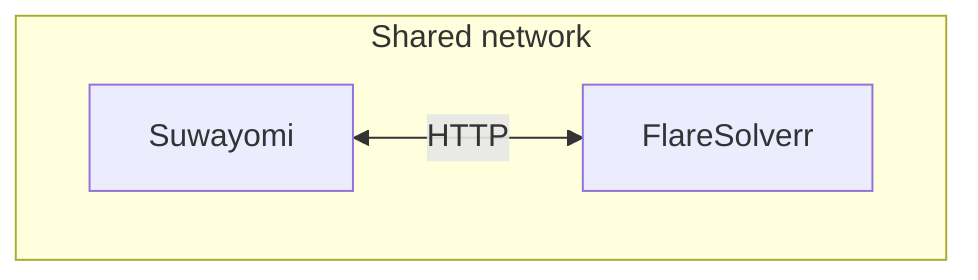

## The preamble

Almost a year has passed since I published the second part of my article series, where I explained how I deployed my Suwayomi server using Podman. That article followed an earlier piece about my initial prototype, and now we're back with part three. Why? Because I realized I'd made some bad decisions. Although everything was working fine, I knew it was time to do things properly, just as I'd promised myself in the conclusion of the previous article.

## The issue

So, let's first recap what I got right. Not everything was entirely wrong. You can read [Part 1](https://mrcarri.dev/posts/software/suwayomi-podman/) and [Part 2](https://mrcarri.dev/posts/software/suwayomi-podman2/) to get an idea of how the original setup worked.

Let's say that:

- Server configuration was done correctly, since I had to do little maintenance.
- Enabling lingering and running the container in rootless mode were the right calls.
- SELinux, data storage, and file permissions were configured correctly, and everything still works today.

Thanks to these choices, I've been able to update the container image several times without any issues. I've been using this instance almost every day, and it works really well. The main issue was that I was using Docker Compose with Podman instead of managing my containers through systemd, which is a more integrated approach.

I also needed to add another container: FlareSolverr. It's a tool that can help bypass certain Cloudflare anti-bot challenges. This became necessary because some websites use Cloudflare to block automated requests and web scrapers.


## How Quadlets work:

Well, it turns out it's a bad pun by the Red Hat developers:

> "what do you get if you squash a Kubernetes kubelet? A quadlet"

Amazing. It's a Kubernetes joke. I had to ask AI to explain it to me, and I still don't find it funny.

Basically, Quadlet is a systemd generator that lets you manage Podman containers through systemd. This means you can manage your containers just like any other systemd service on your Linux server, simplifying maintenance. The best part is that everything integrates with systemd and uses simple, INI-style configuration files. Instead of defining your setup in a Compose file, you define each resource in its own Quadlet file. There's no daemon on the background. No more having to jump into a container to check its logs; just use journalctl. Dependencies? Systemd all the way. Kubernetes? I'll leave that for workloads that actually need it.

Quadlet uses different file extensions depending on the resource being defined:

- .container (for containers)
- .network (for networks)
- .volume (for volumes)
- .pod (for pods). A pod groups containers that need to share resources, such as a network namespace, allowing them to communicate over localhost.

## The structure:

The architecture is simple: two containers connected to a shared network. Both are independently managed by systemd, and I can reuse the FlareSolverr container for other tasks if needed.



Since we're running Podman in rootless mode, we'll store the Quadlet files in the user's configuration directory:

```bash

~/.config/containers/systemd/

```

Let's start with the network. Easy: just give it a name. Done.
**suwayomi.network**

```ini
[Network]
NetworkName=suwayomi

```

Next, the FlareSolverr container. Nothing fancy here, just a standard configuration. The main things to get right are the network configuration and the network alias, which allows the main container to reach FlareSolverr by name.

**suwayomi-flaresolverr.container**
```ini
[Container]
ContainerName=flaresolverr
Environment=TZ=Etc/UTC
Image=ghcr.io/flaresolverr/flaresolverr:latest
Network=suwayomi.network
NetworkAlias=flaresolverr
[Service]
Restart=always


```

And here's the configuration for the Suwayomi container. This part is straightforward too, and most of the settings are the same as in the previous article:

- Same volume configuration, don't forget the :Z flag!
- Same environment variables as the previous compose.

New things: 

I added two environment variables to configure FlareSolverr (these can also be set through the UI), along with the shared network configuration. I also added a systemd dependency to ensure that FlareSolverr is started before Suwayomi.

**suwayomi-suwayomi.container**
```ini
[Unit]
Requires=suwayomi-flaresolverr.service
After=suwayomi-flaresolverr.service

[Container]
Environment=TZ=Europe/Madrid
Environment=FLARESOLVERR_ENABLED=true
Environment=FLARESOLVERR_URL=http://flaresolverr:8191
Exec=/home/suwayomi/startup_script.sh
Group=1000
Image=ghcr.io/suwayomi/tachidesk:stable
User=1000
Volume=/home/carri/suwayomi/data:/home/suwayomi/.local/share/Tachidesk:Z
Network=suwayomi.network
PublishPort=4567:4567
[Service]
Restart=always

```


And then, I just did:

```bash

systemctl --user daemon-reload && systemctl --user start suwayomi-suwayomi.service

```

And then, you can check the status as any service. Please note that we aren't using sudo here!

```bash
systemctl --user status suwayomi-suwayomi.service

```

## Wrap-up

Looking back, the original setup wasn't broken. It was reliable, easy to maintain, and did its job. But moving to Quadlet allowed me to integrate my containers more cleanly with systemd, without relying on a Compose compatibility layer.

The main takeaway is that a working setup isn't necessarily the best long-term setup. Sometimes, taking the time to revisit your original decisions is worth it, especially when it makes future maintenance simpler.

Now, my Suwayomi instance is still running rootless, the data remains persistent, and both containers are managed through systemd. This time, the setup feels much closer to what I originally wanted.